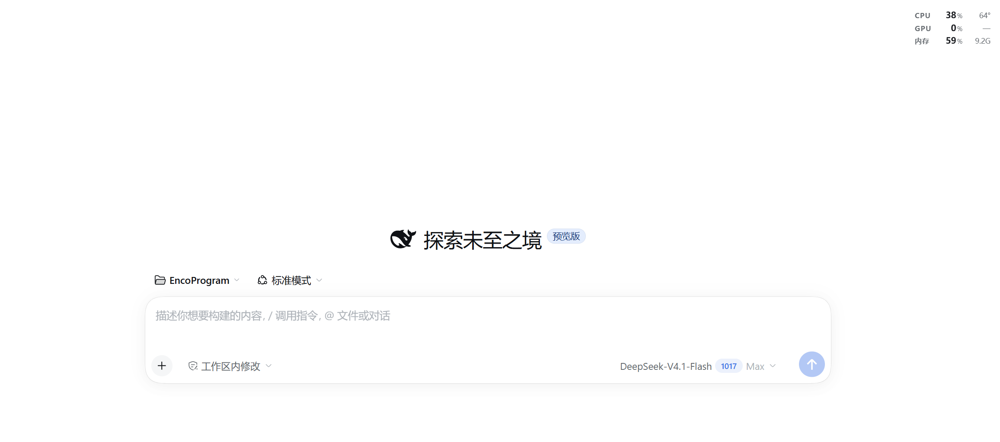

# dsh-perf-hud

A transparent, draggable performance HUD for the DeepSeek Harness web UI:
**CPU / GPU / memory usage**, plus the **CPU package temperature** when the
optional helper is installed.



## Highlights

- **Fully transparent** — no card background, no border. Just three rows of text
  floating over the interface, with a soft halo so it stays readable on any
  content.
- **Drag it anywhere.** On release it anchors to the nearest window corner, so
  maximising, restoring or resizing the window keeps it exactly where you put
  it. Double-click resets to the top-right, arrow keys nudge it, and the chevron
  that appears on hover collapses it to a single row.
- **Load-aware colours** — usage turns amber at 70% and red at 90%; temperature
  at 78 °C / 88 °C. Stale readings dim the whole card instead of flashing a fake
  zero.
- **Theme-aware** — only `--dsw-alias-*` tokens, so it follows light, dark and
  any custom theme.
- **Local only** — the metrics route answers loopback, same-origin requests and
  returns 403 for everything else. Nothing is uploaded.

## Requirements

- **Windows 10/11.** The GPU counters, the PowerShell worker and the temperature
  helper are Windows-specific.
- DeepSeek Harness with the web UI.

## Install

From the Plugins page (install from GitHub or a local folder), or:

```sh
dsh plugin add ChendarCe/dsh-perf-hud
```

Then reload the interface once.

## What it reads

| Metric | Source |
| --- | --- |
| CPU usage | `node:os` CPU-time deltas, once a second |
| Memory usage | `os.totalmem()` / `os.freemem()` — same definition as Task Manager's "In use" |
| GPU usage | Windows `GPU Engine` performance counters, busiest engine (what Task Manager reports) |
| CPU temperature | optional helper — LibreHardwareMonitor's `CPU Package` sensor |
| GPU temperature | only when the GPU exposes a temperature sensor; most integrated GPUs do not, so the cell shows `—` |

## Temperatures (optional)

The plugin works out of the box; without the helper both temperature cells show
`—`. For the real CPU package temperature, run **once** (it asks for
administrator rights):

```
helper\setup.cmd
```

That script downloads and sets up:

- **LibreHardwareMonitor 0.9.6** (portable, library only) — reads the sensors;
- **PawnIO 2.2.0**, a signed kernel driver — required to read MSRs while Windows
  "Memory integrity" (HVCI) stays enabled, so you do **not** have to weaken that
  setting;
- **`sensor-helper.ps1`**, which writes one small JSON file about every 0.4 s;
- a scheduled task **`DSH Perf Sensor`** (at logon, highest privileges, no
  window), so it never asks again.

Files go to `D:\DSHTools` when that drive exists, otherwise
`%LOCALAPPDATA%\DSHTools`. The plugin reads either location.

Measured overhead on an 8-core laptop: **0.08 % of one core and ~87 MB of RAM**
for the helper — it is mostly waiting on the driver, not burning CPU.

Remove it again with:

```
helper\uninstall.ps1              # stops the task, uninstalls the driver
helper\uninstall.ps1 -RemoveFiles # ...and deletes the helper files
```

## Limitations

- Windows only.
- GPU temperatures need a dedicated sensor; Intel integrated GPUs do not expose
  one, and the CPU package temperature is the closest reference (same die).
- The card floats **inside the Harness window**, not as a separate
  always-on-top desktop window.

## 中文说明

DeepSeek Harness 界面里的一块完全透明的性能读数：CPU / GPU / 内存占用率，加上
CPU 封装温度。没有底色和边框，只有三行文字浮在界面上。

- **拖动**卡片任意位置移动，松手后吸附到最近的窗口角，窗口最大化 / 还原 / 改变
  大小都保持位置；**双击**回到右上角，方向键微调，悬停右侧箭头可收起成一行。
- 占用率 ≥70% 变琥珀、≥90% 变红；温度 ≥78 °C / ≥88 °C 同理；读数过期整卡变暗。
- 安装：插件页面安装本仓库，或 `dsh plugin add ChendarCe/dsh-perf-hud`。
- 温度需要可选助手：管理员运行一次 `helper\setup.cmd`（会安装 LibreHardwareMonitor
  与 PawnIO 签名驱动，并注册开机自启任务）。不需要时用 `helper\uninstall.ps1` 移除。
- 没有温度助手时温度一栏显示 `—`；Intel 核显本身没有独立温度传感器，同样显示 `—`。
- 仅支持 Windows；悬浮窗在 Harness 窗口内部，不是独立的桌面置顶窗口。

## License

[MIT](LICENSE)
